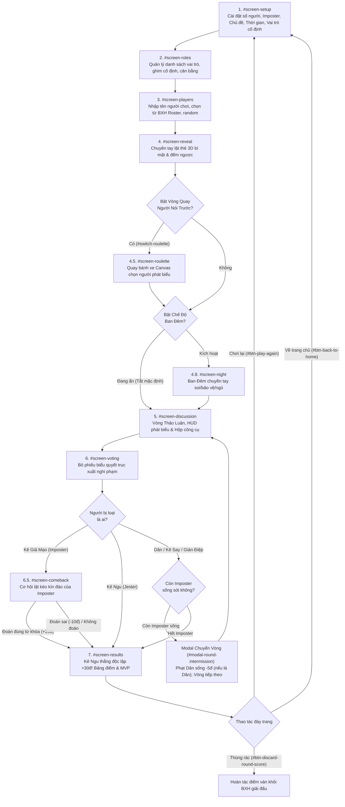

# 🗺️ GUESS THE IMPOSTER - BẢN ĐỒ KIẾN TRÚC & HƯỚNG DẪN TRA CỨU CODE TOÀN DIỆN

> **Tài liệu đặc tả kiến trúc & cẩm nang tra cứu code siêu tốc**: Giúp lập trình viên định vị chính xác 100% file, class, method, HTML ID selector, CSS token và luồng logic khi cần sửa lỗi, mở rộng tính năng hay bảo trì hệ thống.

---

## 📑 Mục Lục
1. [Cấu Trúc Thư Mục & File Dự Án](#-1-cấu-trúc-thư-mục--file-dự-án-project-directory-structure)
2. [Bảng Tra Cứu Nhanh Theo Tính Năng](#-2-bảng-tra-cứu-nhanh-theo-tính-năng-master-feature-lookup-table)
3. [Vòng Đời Ván Chơi & Máy Trạng Thái](#-3-vòng-đời-ván-chơi--máy-trạng-thái-game-state-machine--lifecycle)
4. [Chi Tiết 11 Màn Hình Giao Diện](#-4-chi-tiết-11-màn-hình-giao-diện-view-screens-trong-indexhtml)
5. [Chi Tiết 14 Modals & Bottom Sheets](#-5-chi-tiết-14-modals--bottom-sheets-trong-indexhtml)
6. [Hệ Thống Vai Trò (7 Cốt Lõi + 3 Dự Bị)](#-6-hệ-thống-vai-trò-7-cốt-lõi--3-dự-bị-dormant-roles)
7. [Ma Trận Tính Điểm Toàn Diện](#-7-ma-trận-tính-điểm-toàn-diện-scoring-matrix--rules)
8. [Hệ Thống Giải Đấu, Roster & LocalStorage](#-8-hệ-thống-giải-đấu-roster--localstorage-schema)
9. [Bộ Tổng Hợp Âm Thanh & Haptic](#-9-bộ-tổng-hợp-âm-thanh-web-audio-api--haptic-audiojs)
10. [Hệ Thống Thiết Kế Obsidian Arcade & Mobile Safe-Area](#-10-hệ-thống-thiết-kế-obsidian-arcade--mobile-safe-area-stylescss)
11. [Hệ Thống Ủng Hộ QR Tự Động Techcombank](#-11-hệ-thống-ủng-hộ-qr-tự-động-techcombank-vietqr--clean-qr)

---

## 📂 1. Cấu Trúc Thư Mục & File Dự Án (Project Directory Structure)

```
vuive/
├── index.html                   # Toàn bộ cấu trúc HTML: 11 Màn hình chính & 14 Modals, thẻ meta Android Native
├── manifest.json                # Web App Manifest chuẩn Android PWA / TWA / Standalone mode
├── sw.js                        # Service Worker lưu cache 100% offline tự động cho Android
├── capacitor.config.json        # Cấu hình đóng gói Native Android qua Capacitor (AppId, Splash, StatusBar)
├── package.json                 # Danh mục dependencies & scripts Capacitor Android
├── build-android.ps1            # Script PowerShell tự động 1-click kiểm tra môi trường và build Android Studio
├── server.ps1                   # Script PowerShell khởi chạy HTTP Server kiểm thử nội bộ nhanh trên Windows
├── README.md                    # Tài liệu giới thiệu tổng quan dự án Faker
│
├── css/
│   └── styles.css               # Design System Obsidian Arcade, Safe Area & Chế độ Sáng High-Contrast (~102KB)
│
├── js/
│   ├── app.js                   # Controller trung tâm: State Machine, initAndroidHardware, handleHardwareBack (~264KB)
│   ├── audio.js                 # class SoundManager: Web Audio API & Bộ rung Haptic Native Capacitor/Web (~8KB)
│   ├── data_roles.js            # Dữ liệu 7 vai trò cốt lõi & 3 vai trò dự bị ngầm (~8KB)
│   └── data_categories.js       # 7 danh mục từ vựng tiếng Việt, RANDOM_NAMES & Avatar color palettes (~21KB)
│
├── assets/
│   ├── icons/                   # Bộ icon ứng dụng đa kích thước (1024, 512, 192, 64)
│   │   ├── app_logo.png         # Logo chính thức 1024x1024 px (Mặt nạ & Chiếc khiên Obsidian)
│   │   ├── icon-512.png         # Icon 512x512 px nộp Google Play Store (CH Play)
│   │   ├── icon-192.png         # Icon 192x192 px Android Home Screen & PWA
│   │   └── favicon.png          # Icon 64x64 px tab trình duyệt web
│   └── images/                  # Hình ảnh tài nguyên giao diện
│       ├── techcombank_logo.png # Logo ngân hàng Techcombank trên thẻ thanh toán
│       └── vietqr_donate.png    # Hình ảnh mã QR dự phòng tĩnh phục vụ ủng hộ qua Techcombank
│
├── docs/                        # Trung tâm tài liệu dự án
│   ├── ARCHITECTURE.md          # Bản đồ kiến trúc & Hướng dẫn tra cứu code toàn diện (Tài liệu này)
│   ├── BRANDKIT.md              # Tài liệu quy chuẩn nhận diện thương hiệu độc quyền & bảng mã màu
│   └── CHANGELOG.md             # Nhật ký cập nhật chi tiết (Backnotes) cho từng phiên bản và commit
│
└── tools/                       # Bộ công cụ thiết kế & kịch bản trích xuất
    ├── stitch/                  # Kịch bản API Stitch
    └── stitch_exports/          # Tài nguyên thiết kế giao diện
```

### 💎 Triết Lý Kỹ Thuật (Architecture Principles)
- **Zero-Dependency Core**: Chạy mượt mà trực tiếp không cần framework ngoài (Vanilla JS, CSS3, HTML5).
- **Android Native Ready**: Tích hợp tầng điều khiển phần cứng (Nút Back vật lý, vuốt cạnh màn hình, haptic rung, khóa xoay dọc Portrait, thanh trạng thái).
- **100% Offline Service Worker**: Chạy mượt mà trực tiếp mở file `index.html` hoặc cài đặt thành ứng dụng độc lập không cần mạng.
- **Capacitor Android Packaging**: Sẵn sàng 1 chạm xuất project Android Studio nộp Google Play Store (.aab).
- **Pure Vietnamese Localization**: Chuẩn hóa 100% Tiếng Việt thuần túy, giao diện tối ưu hiển thị trên màn hình di động dọc (Mobile Portrait).

---

## ⚡ 2. Bảng Tra Cứu Nhanh Theo Tính Năng (Master Feature Lookup Table)

| Tính Năng Cần Thao Tác / Sửa Lỗi | File Chứa Code | Hàm (Method) / Từ Khóa Tìm Nhanh | Selector / HTML ID Liên Quan |
| **Xử lý nút Back phần cứng & Vuốt cạnh Android** | [`app.js`](file:///c:/Users/Windows/Documents/APP%20code/vuive/app.js#L375-L485) | `initAndroidHardware`, `handleHardwareBack` (đóng modal, xác nhận hủy ván, double-tap thoát) | `popstate`, `Capacitor.App.backButton` |
| **Rung Haptic phần cứng Native/Web** | [`audio.js`](file:///c:/Users/Windows/Documents/APP%20code/vuive/audio.js#L50-L75) | `vibrate(pattern)` (Tích hợp `Capacitor.Haptics` + `navigator.vibrate`) | `ImpactStyle.LIGHT`, `MEDIUM` |
| **Vòng quay may mắn người nói trước** | [`app.js`](file:///c:/Users/Windows/Documents/APP%20code/vuive/app.js#L1665-L1850) | `showRouletteScreen`, `drawRouletteWheel`, `spinRouletteWheel` | `#screen-roulette`, `#roulette-canvas`, `#btn-spin-wheel` |
| **Thanh HUD người phát biểu & Đếm ngược** | [`app.js`](file:///c:/Users/Windows/Documents/APP%20code/vuive/app.js#L1755-L1820) | `updateCurrentSpeakerHUD`, `startSpeakerTimer`, `nextSpeaker` | `#current-speaker-hud`, `#speaker-timer-text`, `#btn-next-speaker` |
| **Ban Đêm chuyền tay bí mật (Night Phase)** | [`app.js`](file:///c:/Users/Windows/Documents/APP%20code/vuive/app.js#L1827-L2080) | `prepareRoundStart`, `startNightPhase`, `showNightStep`, `renderNightPlayerAction` | `#screen-night`, `#night-curtain-box`, `#night-action-viewport` |
| **Lật thẻ vai trò 3D & Chuyền máy** | [`app.js`](file:///c:/Users/Windows/Documents/APP%20code/vuive/app.js#L1266-L1530) | `showRevealStep`, `startRevealTimer`, `flipCardOpen`, `hideRoleAndAdvance` | `#screen-reveal`, `#reveal-card-3d`, `#btn-flip-card`, `#btn-hide-role` |
| **Thêm / Xóa / Random tên người chơi** | [`app.js`](file:///c:/Users/Windows/Documents/APP%20code/vuive/app.js#L919-L1100) | `generatePlayerInputs`, `deletePlayer`, `addPlayer`, `loadSavedPlayerNames` | `#screen-players`, `#player-inputs-container`, `#btn-add-player` |
| **Chọn danh sách người từ BXH (Roster Picker)** | [`app.js`](file:///c:/Users/Windows/Documents/APP%20code/vuive/app.js#L3588-L3705) | `openRosterPicker`, `applySelectedRoster` | `#modal-roster-picker`, `#btn-pick-roster`, `#roster-members-list` |
| **Đổi tên người chơi (Khóa điểm tuyệt đối)** | [`app.js`](file:///c:/Users/Windows/Documents/APP%20code/vuive/app.js#L3511-L3580) | `openRenamePlayerModal`, `saveRenamedPlayer` | `#modal-rename-player`, `#rename-player-input`, `#btn-confirm-rename` |
| **Gợi ý tự động & Badge điểm thời gian thực** | [`app.js`](file:///c:/Users/Windows/Documents/APP%20code/vuive/app.js#L943-L1050) | `generatePlayerInputs` (lắng nghe input, sync badge) | `#datalist-party-roster`, `.player-score-link-badge` |
| **Tính điểm ván & BXH Party tích lũy** | [`app.js`](file:///c:/Users/Windows/Documents/APP%20code/vuive/app.js#L2691-L3175) | `showResultsScreen`, `renderResultsScoreboard`, `calculateScores` | `#screen-results`, `#results-scoreboard-list`, `partyScores` |
| **Hủy tính điểm ván này (Nút Thùng Rác 🗑️)** | [`app.js`](file:///c:/Users/Windows/Documents/APP%20code/vuive/app.js#L3176-L3228) | `discardCurrentMatchScores` (Hoàn tác điểm ván khỏi `partyScores`) | `#btn-discard-round-score`, `.results-actions-bar` |
| **Đặt lại tất cả điểm giải đấu (Reset)** | [`app.js`](file:///c:/Users/Windows/Documents/APP%20code/vuive/app.js#L3349-L3425) | `resetAllScores`, `executeResetAllScores` | `#modal-confirm-reset`, `#btn-confirm-reset-all` |
| **Phạt Phe Dân biểu quyết oan sai (-5đ)** | [`app.js`](file:///c:/Users/Windows/Documents/APP%20code/vuive/app.js#L2237-L2425) | `submitVotingOutcome`, `calculateScores` (`p.role.team === 'good'`) | Trách nhiệm tập thể chỉ phạt Phe Dân sống; Không phạt Imposter |
| **Phạt Imposter bị bắt Vòng 1 (-15đ / -25đ)** | [`app.js`](file:///c:/Users/Windows/Documents/APP%20code/vuive/app.js#L2865-L2900) | `elimRound === 1` (-10đ bắt + -5đ lộ sớm; nếu đoán sai thêm -10đ) | `#match-timeline-log`, `#results-scoreboard-list` |
| **Cơ hội lật kèo của Imposter (Screen 6.5)** | [`app.js`](file:///c:/Users/Windows/Documents/APP%20code/vuive/app.js#L2636-L2690) | `showComebackStage`, `checkImposterComebackGuess` | `#screen-comeback`, `#comeback-guess-input`, `#btn-submit-guess` |
| **Cấu hình Vai trò cố định (Fixed Roles)** | [`app.js`](file:///c:/Users/Windows/Documents/APP%20code/vuive/app.js#L4993-L5270) | `syncFixedRolesWithDeck`, `setFixedRoleCount`, `renderFixedRolesChips` | `#card-fixed-roles`, `#modal-fixed-roles`, `#screen-roles-fixed-chips` |
| **Quản lý Cặp từ vựng tự tạo (Word Pairs)** | [`app.js`](file:///c:/Users/Windows/Documents/APP%20code/vuive/app.js#L5279-L5910) | `openWordPairsModal`, `addCustomWordPair`, `deleteCustomWordPair` | `#modal-word-pairs`, `#custom-word-pairs-list`, `#form-add-word-pair` |
| **Gián Điệp (Ẩn vai trò khi lật thẻ - Cầm từ đối kháng)** | [`data_roles.js`](file:///c:/Users/Windows/Documents/APP%20code/vuive/data_roles.js#L41-L55) & [`app.js`](file:///c:/Users/Windows/Documents/APP%20code/vuive/app.js#L1322-L1355) | `p.role.id === 'spy'`, `imposterWord` (Sống sót +20đ, bị loại -10đ) | Khi lật thẻ chỉ hiện từ khóa bí mật (y hệt Dân thường); Dân và Gián điệp tranh luận xem ai là Dân thật! |
| **Kẻ Say Rượu (Phe Dân đối trọng Gián Điệp)** | [`data_roles.js`](file:///c:/Users/Windows/Documents/APP%20code/vuive/data_roles.js#L89-L103) & [`app.js`](file:///c:/Users/Windows/Documents/APP%20code/vuive/app.js#L2989-L3012) | `p.role.id === 'drunkard'`, `getDrunkardWord` (Bị vote 0đ, miễn phạt làng) | Sống +20đ, Dân thắng chết +10đ, Gián Điệp sống phạt -10đ |
| **Kẻ Ngu (Jester - Trung Lập)** | [`data_roles.js`](file:///c:/Users/Windows/Documents/APP%20code/vuive/data_roles.js#L57-L71) & [`app.js`](file:///c:/Users/Windows/Documents/APP%20code/vuive/app.js#L2913-L2925) | `p.role.id === 'jester'` (Bị cả làng vote loại: Thắng độc lập +30đ) | Nếu sống sót đến hết ván: 0đ (không bị phạt) |
| **3 Vai trò dự bị (Thám tử, Bác sĩ, Thị trưởng)** | [`data_roles.js`](file:///c:/Users/Windows/Documents/APP%20code/vuive/data_roles.js#L127-L176) & [`app.js`](file:///c:/Users/Windows/Documents/APP%20code/vuive/app.js#L3020-L3030) | `UPCOMING_ROLES`, `detectivesExposedImposter`, `doctorSuccessfulSaves` | Sẵn sàng 100% logic ngầm, chỉ cần chuyển sang `DEFAULT_ROLES` |
| **Hộp công cụ năng lực bí mật (Toolbox)** | [`app.js`](file:///c:/Users/Windows/Documents/APP%20code/vuive/app.js#L3822-L4020) | `openSpecialAbilityToolbox` | `#modal-toolbox`, `#btn-toolbox`, `#toolbox-actions-container` |
| **Modal Ủng hộ qua Techcombank QR** | [`app.js`](file:///c:/Users/Windows/Documents/APP%20code/vuive/app.js#L4038-L4140) | `openDonateModal`, `updateDonateQr`, `applySelectedDonateOption` | `#modal-donate`, `#donate-qr-img`, `#btn-apply-group-split` |
| **Sao chép số tài khoản (Copy STK)** | [`app.js`](file:///c:/Users/Windows/Documents/APP%20code/vuive/app.js#L4120-L4148) | `copyToClipboard`, `fallbackCopyText` | `#btn-copy-stk`, `#donate-stk-text` (`9964823876`) |
| **Cài đặt hệ thống (Giao diện & Âm thanh)** | [`app.js`](file:///c:/Users/Windows/Documents/APP%20code/vuive/app.js#L304-L354) | `openSettingsModal`, `setTheme`, `updateSoundSettingsUI` | `#modal-settings`, `#btn-open-settings`, `#btn-toggle-sound` |
| **Bảng tra cứu luật chơi & Điểm số (Rules)** | [`index.html`](file:///c:/Users/Windows/Documents/APP%20code/vuive/index.html#L1669-L1834) | Mở `#modal-deep-rules` qua nút `btn-open-deep-rules` | `#modal-deep-rules`, `.rules-score-table` |

---

## 🎮 3. Vòng Đời Ván Chơi & Máy Trạng Thái (Game State Machine & Lifecycle)

Mọi quá trình chuyển đổi giao diện trong trò chơi được điều khiển qua phương thức duy nhất `switchScreen(screenId)` trong [`app.js`](file:///c:/Users/Windows/Documents/APP%20code/vuive/app.js#L374-L404).



### Các Biến Trạng Thái Trọng Yếu (`class ImposterGame`)
- `this.players`: Mảng các đối tượng người chơi (`id, name, avatar, avatarBg, role, isImposter, isEliminated, penalty, eliminatedInRound`).
- `this.secretWord` / `this.imposterWord`: Từ khóa bí mật của phe Dân và từ đồng nghĩa của Gián Điệp / Kẻ Say Rượu.
- `this.fixedRoles`: Danh sách các vai trò được người chơi ghim cố định kèm số lượng gán chắc chắn xuất hiện (`{ roleId: count }`).
- `this.partyScores`: Object lưu trữ điểm tích lũy của từng người chơi theo tên (`{ total, wins, games, avatar, avatarBg }`) trên `localStorage`.
- `this.roundNumber`: Số vòng thảo luận/bỏ phiếu hiện tại trong ván chơi.
- `this.winningTeam`: Phe chiến thắng (`'good'`, `'evil'`, hoặc `'jester'`).
- `this.isCurrentRoundScoreDiscarded`: Cờ đánh dấu điểm ván hiện tại đã bị hủy bằng nút Thùng Rác hay chưa.

---

## 🖥️ 4. Chi Tiết 11 Màn Hình Giao Diện (View Screens trong `index.html`)

Mỗi màn hình là một thẻ `<section id="screen-..." class="view-screen">`:

### 1. `#screen-setup` (Screen 1 - Cài đặt ván chơi)
- **Banner giải đấu tích lũy (`#setup-tournament-banner`)**: Hiển thị người dẫn đầu BXH Party và tổng số ván đã chơi.
- **Bộ đếm số người chơi & số Imposter**: Nút tăng giảm `-` / `+` với ngưỡng giới hạn an toàn tự động.
- **Thẻ Tùy chọn chủ đề từ vựng**:
  - `#opt-topic-specific`: Chọn danh mục từ vựng cụ thể (Đồ ăn, Động vật, Địa điểm, v.v.).
  - `#opt-topic-random`: Hệ thống tự chọn ngẫu nhiên chủ đề bất ngờ mỗi ván.
- **Cấu hình thời gian & Trải nghiệm**:
  - `#switch-roulette`: Công tắc bật/tắt Vòng quay người nói trước.
  - `#val-time` & `#val-speech-time`: Thời gian thảo luận tổng ván và thời gian phát biểu mỗi người.
- **Thẻ Vai trò cố định (`#card-fixed-roles`)**: Hiển thị danh sách chip vai trò chắc chắn xuất hiện kèm số lượng, nút mở nhanh modal cấu hình.

### 2. `#screen-roles` (Screen 2 - Quản lý cấu hình vai trò)
- **Thanh lọc danh mục vai trò**: Các filter chip `Tất cả (7)`, `Phe Dân`, `Phe Ác`, `Trung Lập`, `📌 Cố định`.
- **Thước đo cân bằng phe (`#balance-meter-fill`)**: Tính toán tỷ lệ phần trăm cân bằng lực lượng giữa phe Dân và phe Ác theo thời gian thực.
- **Danh sách thẻ vai trò (`#roles-list-container`)**: Từng thẻ có nút ghim vai trò cố định trực tiếp kèm bộ điều chỉnh số lượng `- [count] +`.
- **Nút tạo vai trò mới (`#btn-create-custom-role`)**: Mở Modal tạo vai trò tùy biến.

### 3. `#screen-players` (Screen 3 - Tên người chơi & Roster)
- **Thao tác nhanh**:
  - Nút **`👥 Chọn từ BXH`** (`#btn-pick-roster`): Mở Modal Roster Picker chọn thành viên từ lịch sử giải đấu.
  - Nút **`🎲 Đổi tên tất cả`** (`#btn-random-names`): Gán tên ngẫu nhiên vui nhộn từ danh mục `RANDOM_NAMES`.
  - Nút **`➕ Thêm người chơi`** (`#btn-add-player`): Thêm người chơi mới vào ván.
- **Từng dòng người chơi (`.player-input-row`)**:
  - Avatar đổi màu tự động, ô input nhập tên tích hợp `<datalist id="datalist-party-roster">` tự động gợi ý.
  - Badge phát sáng `🏆 X pts` tự động hiển thị khi tên người chơi trùng khớp hồ sơ trên BXH giải đấu.
  - Nút xúc xắc 🎲 đổi tên đơn lẻ và nút thùng rác 🗑️ xóa người chơi.

### 4. `#screen-reveal` (Screen 4 - Lật thẻ vai trò bí mật chuyền tay)
- **Màn che bảo mật (`#reveal-curtain-box`)**: Nhắc nhở người chơi cầm máy riêng tư trước khi xem.
- **Thẻ bài 3D chạm để lật (`#reveal-card-3d`)**: Lật mặt sau hiển thị Icon vai trò, Phù hiệu phe, Từ khóa bí mật (hoặc nhãn `TỪ ĐỒNG NGHĨA TRONG CẶP:` với Gián Điệp / Kẻ Say Rượu).
- **Thanh tiến trình đếm ngược lật thẻ**: Tự động cảnh báo chuyển người tiếp theo nếu người chơi xem quá lâu.

### 5. `#screen-roulette` (Screen 4.5 - Vòng quay may mắn ai nói trước)
- **Vòng quay Canvas (`#roulette-canvas`)**: Tự động chia nan quạt màu sắc theo danh sách người chơi trong ván.
- **Nút QUAY ở tâm (`#btn-spin-wheel`)**: Kích hoạt hiệu ứng quay gia tốc & giảm tốc vật lý chân thực.
- **Hộp thông báo kết quả (`#roulette-result-card`)**: Công bố tên người được chọn nói đầu tiên và thứ tự phát biểu.

### 6. `#screen-night` (Screen 4.8 - Ban Đêm Bí Mật Chuyền Tay - Pass-the-Phone)
- **Màn che bảo mật đêm (`#night-curtain-box`)**: Chuyền tay cho từng người thức dậy trong bóng đêm.
- **Viewport hành động bí mật (`#night-action-viewport`)**: Hiển thị form năng lực riêng cho từng vai trò (Thám tử soi danh tính, Bác sĩ đặt khiên cứu sống, Gián điệp xem từ đồng nghĩa, v.v.).
- *(Lưu ý: Chế độ ban đêm hiện tại được tắt mặc định để tối giản trải nghiệm party game nhanh).*

### 7. `#screen-discussion` (Screen 5 - Vòng thảo luận & Đồng hồ)
- **Đồng hồ đếm ngược ván chơi (`#countdown-timer-circle`)**: Đồ họa vòng tròn SVG đếm ngược kèm màu cảnh báo khẩn cấp khi dưới 30s.
- **Thanh HUD người đang phát biểu (`#current-speaker-hud`)**: Hiển thị Avatar, Tên, Đồng hồ đếm ngược lượt nói của cá nhân và nút **Xong lượt ⏭️** (`#btn-next-speaker`).
- **Dải Avatar người chơi (`#speakers-strip-container`)**: Cho phép quản trò chạm trực tiếp vào bất kỳ người chơi nào để chuyển quyền phát biểu ngay lập tức.
- **Nút Hộp công cụ năng lực bí mật (`#btn-toolbox`)**: Mở Modal Toolbox kiểm tra lại vai trò hoặc kích hoạt kỹ năng.

### 8. `#screen-voting` (Screen 6 - Bỏ phiếu loại)
- **Lưới danh sách người chơi (`#voting-grid`)**: Hiển thị thẻ từng người để biểu quyết trục xuất nghi phạm.
- **Cảnh báo trách nhiệm tập thể**: Nhắc nhở rõ ràng hình phạt `-5 điểm` cho toàn bộ Phe Dân còn sống nếu bỏ phiếu nhầm Dân vô tội.
- **Nút bỏ qua vòng vote (`#btn-skip-voting`)**: Sử dụng khi cả nhóm không thống nhất được ý kiến hoặc muốn thảo luận thêm.

### 9. `#screen-comeback` (Screen 6.5 - Cơ hội lật kèo của Imposter)
- **Màn hình bảo mật tách biệt**: Quản trò chuyền máy riêng cho Imposter vừa bị vạch mặt.
- **Giao diện gõ từ khóa (`#comeback-guess-input`)**: Tuyệt đối che giấu từ khóa chính xác của ván, cho Imposter 30 giây để nhập từ suy đoán.
- **Nút Bỏ qua / Không đoán (`#btn-skip-guess`)**: Bảo toàn điểm, chịu -10đ bị bắt thông thường mà không bị phạt thêm -10đ đoán sai.

### 10. `#screen-results` (Screen 7 - Kết quả ván & Bảng điểm)
- **Banner vinh danh đội thắng (`#result-winner-banner`)**: Đổi màu sống động kèm hiệu ứng pháo hoa Confetti.
- **Thẻ lật mặt Kẻ Giả Mạo (`.unmask-reveal-box`)**: Công bố tên Imposter thực sự và từ khóa bí mật của ván đấu.
- **Badge lật kèo (`#results-comeback-badge`)**: Thông báo chi tiết kết quả đoán từ lật kèo của Imposter.
- **Bảng điểm 2 Tab**:
  - `Tab ⚡ Điểm ván này`: Danh sách từng người chơi, số điểm thay đổi (`+` / `-`) và dòng lý do chi tiết kèm danh hiệu MVP ván.
  - `Tab 👑 Tổng tích lũy giải đấu`: Bảng xếp hạng toàn bộ thành viên từ trước đến nay.
- **Thanh thao tác cố định dưới đáy (`.results-actions-bar`)**:
  - Nút **`🏠`** (`#btn-back-to-home`): Về màn hình cài đặt trang chủ.
  - Nút **`🔄`** (`#btn-play-again`): Bắt đầu ván mới ngay lập tức với cùng danh sách người chơi.
  - Nút **`🗑️ Không tính điểm`** (`#btn-discard-round-score`): Hoàn tác toàn bộ điểm số của ván đấu khỏi BXH giải đấu (sử dụng khi ván chơi thử hoặc có sự cố kỹ thuật).

### 11. `#screen-history` (Screen 8 - Lịch sử ván chơi)
- Danh sách các ván đấu đã diễn ra được lưu trữ trong `localStorage` (`gti_history`), cho phép xem lại chi tiết diễn biến từng ván và nút xóa lịch sử.

---

## 🪟 5. Chi Tiết 14 Modals & Bottom Sheets (trong `index.html`)

Tất cả modal được thiết kế dưới dạng Bottom Sheet hoặc Center Modal với class `.modal-overlay` và mở bằng cách thêm class `.open`:

| STT | ID Modal Selector | Tên / Chức Năng | Nút / Thao Tác Kích Hoạt | Hàm Mở Trong [`app.js`](file:///c:/Users/Windows/Documents/APP%20code/vuive/app.js) |
| :---: | :--- | :--- | :--- | :--- |
| **1** | `#modal-settings` | Cài đặt hệ thống (Theme Obsidian, Âm thanh Web Audio, Rung Haptic, Phiên bản) | Nút bánh răng `⚙️` góc trên bên phải header | `openSettingsModal()` (dòng 304) |
| **2** | `#modal-donate` | Ủng hộ nhà phát triển qua mã QR Techcombank (VietQR chuẩn không logo) | Nút trái tim `☕ Ủng hộ` trên header / kết quả | `openDonateModal()` (dòng 4038) |
| **3** | `#modal-deep-rules` | Tra cứu chi tiết toàn bộ luật chơi & hệ thống điểm số từng vai trò | Nút `📖 Luật chơi chi tiết` trên header / setup | Event listener mở trực tiếp modal |
| **4** | `#modal-fixed-roles` | Cấu hình vai trò cố định chắc chắn xuất hiện trong ván kèm số lượng | Nút `⚙️ Cấu hình` trên `#card-fixed-roles` | `openFixedRolesModal()` (dòng 5167) |
| **5** | `#modal-word-pairs` | Quản lý, tìm kiếm, thêm, sửa, xóa các cặp từ vựng & chủ đề tùy chỉnh | Nút `✏️ Quản lý cặp từ` trong mục chủ đề | `openWordPairsModal()` (dòng 5364) |
| **6** | `#modal-categories` | Chọn chủ đề từ vựng quen thuộc cho ván chơi | Nút `Đổi chủ đề ›` trên `#opt-topic-specific` | `openCategoriesPicker()` (dòng 5913) |
| **7** | `#modal-roster-picker` | Chọn danh sách người chơi nhanh từ BXH tích lũy giải đấu vào ván mới | Nút `👥 Chọn từ BXH` trên `#screen-players` | `openRosterPicker()` (dòng 3588) |
| **8** | `#modal-rename-player` | Đổi tên người chơi từ BXH mà **khóa điểm tuyệt đối** không bị mất | Nút cây bút ✏️ bên cạnh tên trên bảng BXH | `openRenamePlayerModal(name)` (dòng 3511) |
| **9** | `#modal-leaderboard` | Xem Bảng xếp hạng tích lũy Party đầy đủ kèm danh hiệu và tỷ lệ thắng | Nút vương miện `👑 BXH` trên header | `renderCumulativeLeaderboard()` (dòng 3428) |
| **10** | `#modal-confirm-reset` | Hộp thoại xác nhận đặt lại toàn bộ điểm số giải đấu về 0 | Nút `🔄 Đặt lại tất cả điểm` trên BXH | `resetAllScores()` (dòng 3349) |
| **11** | `#modal-custom-role` | Tạo vai trò tùy biến mới (Phe, Tên, Icon, Màu, Kỹ năng, Điều kiện thắng) | Nút `➕ Tạo vai trò` trên `#screen-roles` | Event listener mở modal tạo role |
| **12** | `#modal-toolbox` | Hộp công cụ năng lực bí mật của từng người chơi trong vòng thảo luận | Nút `🎒 Năng lực bí mật` trên `#screen-discussion` | `openSpecialAbilityToolbox()` (dòng 3822) |
| **13** | `#modal-round-intermission`| Chuyển vòng thảo luận kế tiếp khi loại nhầm dân hoặc chưa hết Imposter | Tự động kích hoạt khi biểu quyết chưa kết thúc ván | `showRoundIntermission()` (dòng 2429) |
| **14** | `#modal-action-notice` | Hộp thoại thông báo xác nhận hành động cao cấp (thay thế alert/confirm) | Kích hoạt khi cần cảnh báo nguy hiểm / xác nhận | `showActionNotice(options)` (dòng 3270) |

---

## 🎭 6. Hệ Thống Vai Trò (7 Cốt Lõi + 3 Dự Bị Dormant Roles)

Toàn bộ thông số vai trò được khai báo trong [`data_roles.js`](file:///c:/Users/Windows/Documents/APP%20code/vuive/data_roles.js).

### 7 Vai Trò Cốt Lõi Đang Hoạt Động (`DEFAULT_ROLES`)
1. **👤 Dân Thường (Civilian - Phe Dân `#10B981`)**:
   - Biết từ khóa bí mật. Không có năng lực đặc biệt.
   - Phe Dân thắng: tất cả +10đ. Dân còn sống vote đúng Kẻ Giả Mạo & Trung Lập: +5đ/kẻ (lũy kế).
   - Vote sai: Dân còn sống bị trừ -5đ. Thua trận: -5đ.
2. **🎭 Kẻ Giả Mạo (Imposter - Phe Ác `#EF4444`)**:
   - Không biết từ khóa bí mật, chỉ biết chủ đề chung. Nhận gợi ý nếu bật.
   - Sống sót thắng ván: **`+20 điểm`** (Cập nhật mới).
   - Lật kèo đoán đúng từ khóa: **`+20 điểm`** (miễn trừ mọi hình phạt bị bắt hay lộ sớm).
   - Bị bắt: Phạt `-10 điểm` (nếu bị bắt ngay Vòng 1 phạt thêm `-5 điểm` = `-15 điểm`). Nếu đoán sai từ phạt thêm `-10 điểm` (tổng `-20đ` hoặc `-25đ`).
   - **Tuyệt đối không bị trừ điểm vote sai dân làng**.
3. **🕵️ Gián Điệp (Spy - Phe Trung Lập `#8B5CF6`)**:
   - Nhận **từ đồng nghĩa trong cặp từ** (`imposterWord`), khác từ khóa của phe Dân. Không biết ai là Imposter.
   - Thắng độc lập khi **SỐNG SÓT đến cuối ván: `+20 điểm`**.
   - Bị phát hiện & trục xuất: `-10 điểm`. Biểu quyết đúng hay sai đều `0 điểm`.
4. **🤪 Kẻ Ngu (Jester - Phe Trung Lập `#EC4899`)**:
   - Biết từ khóa bí mật. Mục tiêu duy nhất là làm cho cả làng nghi ngờ và bỏ phiếu trục xuất mình.
   - Bị vote loại: **Thắng độc lập `+30 điểm`** (tất cả người chơi khác đều 0đ, không ai bị trừ điểm).
   - Sống sót đến cuối ván: `0 điểm` (thất bại nhưng không bị phạt trừ điểm).
5. **🗡️ Kẻ Phản Bội (Traitor - Phe Ác `#DC2626`)**:
   - Thuộc phe Ác nhưng **biết từ khóa bí mật** để ngầm dẫn dắt, tạo hỏa mù khiến Dân nghi ngờ lẫn nhau.
   - Phe Kẻ Giả Mạo thắng: `+15 điểm`. Bị bắt hoặc phe Ác thua: `-10 điểm`.
6. **🍺 Kẻ Say Rượu (Drunkard - Phe Dân `#059669`)**:
   - Thuộc **Phe Dân** nhưng do say xỉn nên cầm nhầm **từ đồng nghĩa của Gián Điệp** (`imposterWord`).
   - **Cơ chế miễn phạt toàn diện**: Khi Kẻ Say Rượu bị vote loại, bản thân nhận `0 điểm` và **cả làng Phe Dân được MIỄN PHẠT** không bị trừ -5đ vote oan.
   - Phe Dân thắng: Kẻ Say còn sống nhận **`+20 điểm`**; đã bị loại trước đó nhận `+10 điểm`.
   - Gián Điệp sống sót thắng ván: Kẻ Say bị phạt `-10 điểm`. Imposter thắng: Kẻ Say nhận `0 điểm`.
7. **🎭 Điệp Viên Hai Mang (Double Agent - Phe Trung Lập `#64748B`)**:
   - Biết từ khóa và biết danh tính Kẻ Giả Mạo.
   - Giúp Imposter thắng hoặc là người cuối cùng sống sót: `+15 điểm`. Bị loại hoặc thất bại: `-5 điểm`.

---

### 🔮 3 Vai Trò Dự Bị Đã Xây Dựng Hoàn Thiện (`UPCOMING_ROLES`)
Toàn bộ logic dữ liệu, hook hộp công cụ, kiểm tra khiên bảo vệ và tính điểm đã sẵn sàng 100% trong mã nguồn nhưng ở trạng thái ngủ (dormant) để không gây rối giao diện hiện tại:

1. **🔍 Thám Tử (Detective - Phe Dân `#3B82F6`)**:
   - Dữ liệu: `UPCOMING_ROLES[0]` (`isPublic: false`).
   - Kỹ năng: Dùng Hộp Công Cụ để soi danh tính 1 người chơi. Soi trúng phe Ác (Imposter/Traitor) nhận thưởng ngay `+5 điểm` trong ván (`detectivesExposedImposter`).
   - Thắng/Thua: Dân thắng +10đ; Soi trúng Ác +5đ/lần; Thua ván -5đ.
2. **💉 Bác Sĩ (Doctor - Phe Dân `#06B6D4`)**:
   - Dữ liệu: `UPCOMING_ROLES[1]` (`isPublic: false`).
   - Kỹ năng: Đặt Khiên Bảo Vệ (`doctorShieldedPlayerIds`) cho 1 người bất kỳ. Nếu người đó bị vote loại, án tử được hóa giải ngay, không ai bị loại và Bác Sĩ nhận thưởng ngay `+10 điểm` (`doctorSuccessfulSaves`).
   - Thắng/Thua: Dân thắng +10đ; Cứu sống thành công +10đ/lần; Thua ván -5đ.
3. **👑 Thị Trưởng (Mayor - Phe Dân `#F59E0B`)**:
   - Dữ liệu: `UPCOMING_ROLES[2]` (`isPublic: false`).
   - Kỹ năng: Lá phiếu biểu quyết có trọng số gấp đôi (`x2 Phiếu`) khi bỏ phiếu loại nghi phạm.
   - Thắng/Thua: Dân thắng +10đ; Thua ván -5đ.

> 💡 **Cách Kích Hoạt 1 Chạm Khi Muốn Public Lên Ứng Dụng**:
> Chỉ cần chuyển các vai trò từ `UPCOMING_ROLES` sang `DEFAULT_ROLES` trong [`data_roles.js`](file:///c:/Users/Windows/Documents/APP%20code/vuive/data_roles.js#L127-L176) và đặt `enabled: true, isPublic: true`. Toàn bộ hệ thống UI và logic tính điểm trong `app.js` sẽ tự kích hoạt ngay lập tức mà không cần viết thêm mã.

---

## ⚖️ 7. Ma Trận Tính Điểm Toàn Diện (Scoring Matrix & Rules)

Triển khai tại `calculateScores` trong [`app.js`](file:///c:/Users/Windows/Documents/APP%20code/vuive/app.js#L2851-L3050):

| Vai Trò | Kịch Bản & Trạng Thái Cuối Ván | Điểm Thay Đổi (Delta) | Ghi Chú & Điều Kiện Phạt |
| :--- | :--- | :---: | :--- |
| **Kẻ Giả Mạo (Imposter)** | Sống sót đến cuối ván | **+20đ** | Imposter chiến thắng chung cuộc |
| | Bị bắt nhưng **Lật Kèo đoán trúng từ** | **+20đ** | Miễn trừ mọi hình phạt bị bắt hay lộ sớm |
| | Bị bắt ở **Vòng 1** (Không đoán từ / Bỏ qua) | **-15đ** | -10đ bị bắt + -5đ lộ sớm vòng 1 |
| | Bị bắt ở **Vòng 1 & Đoán sai từ** | **-25đ** | -10đ bị bắt + -5đ lộ sớm + -10đ đoán sai |
| | Bị bắt ở **Vòng sau** (Không đoán từ / Bỏ qua) | **-10đ** | Chỉ chịu phạt bị trục xuất thông thường |
| | Bị bắt ở **Vòng sau & Đoán sai từ** | **-20đ** | -10đ bị trục xuất + -10đ đoán sai |
| | *Trách nhiệm tập thể khi Dân bị loại nhầm* | **0đ** | **Tuyệt đối KHÔNG trừ điểm Imposter khi Dân vote nhầm** |
| **Dân Thường (Civilian)** | Phe Dân chiến thắng chung cuộc | **+10đ** | Áp dụng cho toàn bộ người chơi phe Dân |
| | Dân còn sống vote đúng Imposter/Trung lập | **+5đ / kẻ** | Điểm thưởng lũy kế theo số kẻ ác/trung lập bị bắt |
| | Thua trận trước Imposter (Imposter sống/lật kèo) | **-5đ** | Toàn bộ phe Dân bị trừ điểm thua ván |
| | Phe Dân vote nhầm Dân thường vô tội | **-5đ / lần** | **Chỉ trừ Dân còn sống** (`team === 'good' && id !== 'drunkard'`) |
| **Gián Điệp (Spy - Trung Lập)** | Sống sót đến cuối ván | **+20đ** | Thắng độc lập bất kể phe Dân hay Imposter thắng |
| | Bị biểu quyết trục xuất | **-10đ** | Bị phát hiện và loại khỏi ván |
| | Biểu quyết người khác đúng hoặc sai | **0đ** | Không nhận thưởng vote, không bị phạt vote nhầm |
| **Kẻ Say Rượu (Drunkard - Phe Dân)**| Phe Dân thắng & Kẻ Say còn sống | **+20đ** | Thưởng sinh tồn tài tình khi cầm từ lệch |
| | Phe Dân thắng nhưng Kẻ Say đã bị loại | **+10đ** | Hưởng điểm thắng chung cuộc của phe Dân |
| | Bị cả làng biểu quyết loại | **0đ** | **Bảo toàn điểm và MIỄN PHẠT vote oan cho cả làng** |
| | Gián Điệp sống sót thắng ván | **-10đ** | Thất bại trước đối thủ trực diện Gián Điệp |
| | Imposter thắng ván chung cuộc | **0đ** | Không bị trừ điểm thua trận |
| **Kẻ Ngu (Jester - Trung Lập)** | Bị cả làng biểu quyết loại | **+30đ** | Thắng độc lập tuyệt đối; mọi người khác nhận 0đ |
| | Không bị loại đến cuối ván | **0đ** | Thất bại nhưng không bị phạt trừ điểm |
| **Kẻ Phản Bội (Traitor - Phe Ác)** | Phe Kẻ Giả Mạo chiến thắng | **+15đ** | Thắng cùng phe Ác |
| | Phe Ác thua hoặc bản thân bị loại | **-10đ** | Chịu phạt phe Ác thất bại |
| **Điệp Viên Hai Mang (Double Agent)**| Giúp Imposter thắng / Người sống sót cuối | **+15đ** | Điều kiện thắng độc lập |
| | Bị loại hoặc phe Ác thua | **-5đ** | Thất bại |

---

## 🏆 8. Hệ Thống Giải Đấu, Roster & LocalStorage Schema

### Cấu Trúc Bảng Điểm Tích Lũy Giải Đấu (`partyScores`)
Lưu trữ dưới dạng JSON string trong `localStorage.getItem('gti_party_scores')`:
```javascript


```

### Cơ Chế Bảo Vệ Toàn Vẹn Dữ Liệu
1. **Nút Thùng Rác Hủy Điểm Ván (`#btn-discard-round-score`)**:
   - Khi bấm, hàm `discardCurrentMatchScores()` hoàn tác chính xác lượng điểm `delta` của từng người chơi khỏi `partyScores`, giảm số ván `games` và số ván thắng `wins`, đồng thời xóa ván đấu khỏi lịch sử `gti_history`.
   - Ngăn chặn triệt để tình trạng điểm số bị cộng nhầm khi ván đấu bị gián đoạn hoặc chơi thử.
2. **Đổi Tên Khóa Điểm Tuyệt Đối (`#modal-rename-player`)**:
   - Hàm `saveRenamedPlayer()` chuyển giao toàn bộ điểm số từ tên cũ sang tên mới, cập nhật tất cả lịch sử và đóng modal, loại bỏ hoàn toàn khả năng người dùng can thiệp sửa điểm số.
3. **Danh Sách 18 Khóa LocalStorage Đang Sử Dụng**:
   - `gti_party_scores`: Bảng điểm tích lũy Party Tournament.
   - `gti_player_names`: Danh sách tên người chơi phiên gần nhất.
   - `gti_fixed_roles`: Danh sách cấu hình vai trò ghim cố định kèm số lượng.
   - `gti_custom_word_pairs`: Danh sách các cặp từ vựng tùy chỉnh người dùng tạo.
   - `gti_custom_categories`: Danh mục chủ đề từ vựng tùy chỉnh.
   - `gti_custom_roles`: Danh sách các vai trò tùy chỉnh.
   - `gti_history`: Lịch sử các ván đấu đã kết thúc.
   - `gti_theme`: Tên theme giao diện đang chọn (`obsidian`, `dark`, v.v.).
   - `gti_sound_muted` / `gti_sound_volume`: Trạng thái tắt/bật và âm lượng âm thanh.
   - `gti_haptic`: Trạng thái bật/tắt rung phản hồi thiết bị.
   - `gti_discussion_time` / `gti_speech_time`: Thời gian thảo luận và phát biểu.
   - `gti_roulette`: Trạng thái bật/tắt vòng quay người nói trước.
   - `gti_players`: Số người chơi mặc định.
   - `gti_category_mode`: Chế độ chủ đề (`specific` hoặc `random`).
   - `gti_special_role_rate`: Tỷ lệ xuất hiện vai trò đặc biệt.
   - `gti_night_phase`: Trạng thái chế độ ban đêm.

---

## 🎵 9. Bộ Tổng Hợp Âm Thanh Web Audio API & Haptic (`audio.js`)

Triển khai qua class `SoundManager` trong [`audio.js`](file:///c:/Users/Windows/Documents/APP%20code/vuive/audio.js):

### Danh Mục 10 Hiệu Ứng Âm Thanh & Rung
1. `vibrate(pattern)`: Rung haptic vật lý qua `navigator.vibrate` (15ms - 80ms).
2. `playClick()`: Click nhẹ giao diện (Sóng Sine 600Hz ➔ 120Hz trong 0.05s).
3. `playToggle()`: Bật/tắt công tắc (Sóng Triangle 320Hz ➔ 680Hz).
4. `playFlipCard()`: Lật thẻ bài 3D bí mật (Sóng Sine 180Hz ➔ 420Hz, rung 30ms).
5. `playTick()`: Nhịp đồng hồ đếm ngược thông thường (Woodblock click 800Hz).
6. `playEmergencyTick()`: Nhịp đồng hồ báo động khẩn cấp khi thời gian dưới 10 giây (1200Hz).
7. `playGavel()`: Tiếng búa quan tòa gõ công bố kết quả biểu quyết (Sine 140Hz ➔ 30Hz trầm hùng).
8. `playGong()`: Tiếng cồng chiêng mở màn ván đấu (Sine 220Hz ngân vang 2.5s).
9. `playDramaticReveal()`: Tiếng vạch mặt Kẻ Giả Mạo kịch tính (Dissonant chord hợp âm giảm).
10. `playWinFanfare()`: Tiếng kèn chiến thắng (Arpeggio chuỗi nốt Đô - Mi - Sol - Đố).

---

## 🎨 10. Hệ Thống Thiết Kế Obsidian Arcade & Mobile Safe-Area (`styles.css`)

Triển khai trong [`styles.css`](file:///c:/Users/Windows/Documents/APP%20code/vuive/styles.css):

### Bảng Mã Màu Chủ Đạo (Obsidian Arcade Palette)
- **Nền ứng dụng (Background)**: `#0D0E15` (Obsidian Deep Dark), thẻ card `#161824`.
- **Màu thương hiệu chính (Primary Accent)**: `linear-gradient(135deg, #6366F1 0%, #8B5CF6 100%)` (Arcade Indigo/Violet).
- **Phe Dân (Good Team)**: `#10B981` (Emerald Green) & `#06B6D4` (Cyan).
- **Phe Ác (Evil Team)**: `#EF4444` (Vibrant Crimson) & `#DC2626` (Deep Red).
- **Trung Lập (Neutral Team)**: `#EC4899` (Hot Pink) & `#8B5CF6` (Purple).
- **Cảnh báo / Lật kèo (Comeback)**: `#F59E0B` (Amber Gold).

### Tối Ưu Hóa Trình Duyệt Di Động & Safari Safe Area
- **Thanh thao tác cố định (`.results-actions-bar`)**:
  ```css
  position: sticky;
  bottom: 0;
  padding: 12px 16px max(18px, env(safe-area-inset-bottom, 18px));
  background: rgba(13, 14, 21, 0.95);
  backdrop-filter: blur(16px);
  ```
  Ngăn chặn hoàn toàn hiện tượng thanh điều hướng URL của Safari trên iPhone đè che lấp 3 nút chức năng.
- **Tự động cuộn đỉnh trang (`scrollTop = 0`)**: Phương thức `switchScreen()` tự động đưa màn hình về vị trí 0px khi chuyển màn, đảm bảo người chơi nhìn thấy thông báo Kẻ Giả Mạo ngay khi ván kết thúc.
- **Thẻ vạch mặt Kẻ Giả Mạo (`.unmask-reveal-box`)**: Tích hợp `overflow: hidden` và header mờ `0.95` loại bỏ hoàn toàn viền đỏ lem nhem khi cuộn trang.

---

## ☕ 11. Hệ Thống Ủng Hộ QR Tự Động Techcombank (VietQR & Clean QR)

Triển khai tại `openDonateModal` và `updateDonateQr` trong [`app.js`](file:///c:/Users/Windows/Documents/APP%20code/vuive/app.js#L4038-L4118):

### Cơ Chế Tạo Mã QR Sạch 100% (Không Logo Ở Giữa)
1. **Gọi API VietQR** (`https://api.vietqr.io/v2/generate`) với tham số `format: 'text', template: 'qr_only'` để lấy chuỗi dữ liệu EMVCo thanh toán ngân hàng thuần túy.
2. **Render qua QRServer** (`https://api.qrserver.com/v1/create-qr-code/?data=...`): Chuyển chuỗi EMVCo thành hình ảnh QR rõ nét, **hoàn toàn sạch không chứa logo ngân hàng hay watermark ở tâm**, đảm bảo mọi app ngân hàng (Techcombank, Vietcombank, MB, Momo) quét thanh toán thành công 100%.
3. **Các Mức Chọn Nhanh Đã Chuẩn Hóa**:
   - `Tùy tâm 💝`: Tải ảnh tĩnh gốc `vietqr_donate.png`.
   - `10.000đ` (Cốc trà đá 🧊).
   - `20.000đ` (Bánh mì 🥖).
   - `50.000đ` (Cà phê ☕).
   - `100.000đ` (Bữa trưa 🍱).
4. **Đồng Bộ Tiêu Đề Phụ & Toast**: Khi bấm chọn bất kỳ mức nào, tiêu đề phụ `#donate-active-amount-label` đổi ngay lập tức, nút cam cập nhật số tiền `Tạo QR (50.000đ)` và hiển thị Toast trang nhã không lặp từ.
5. **Thông Tin Tài Khoản Mặc Định**:
   - Ngân hàng: **Techcombank** (Ngân hàng Kỹ thương Việt Nam).
   - Số tài khoản: **`9964823876`** (Nút sao chép 1 chạm hỗ trợ `navigator.clipboard` & fallback `execCommand`).
   - Tên chủ tài khoản: **VU BAO NGUYEN**.
